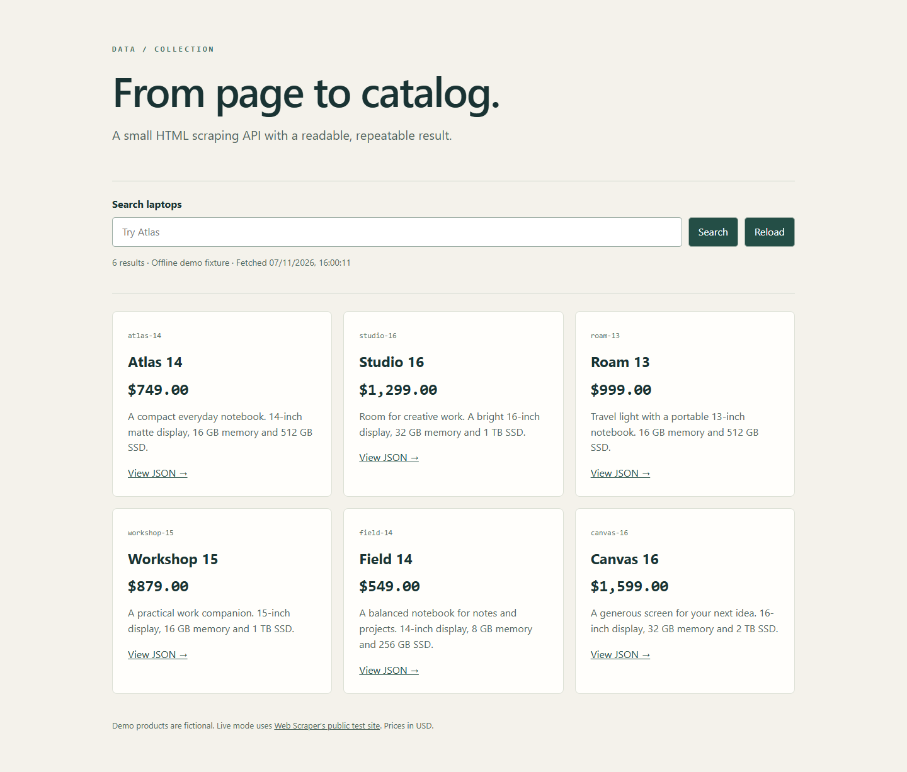

# Catalog scraper

Turn a public HTML catalog into a small, predictable JSON API. Includes a searchable browser preview, a repeatable offline fixture and an opt-in live collector.



This is a refreshed portfolio edition of an earlier technical exercise. The current implementation, demo data and interface were revised in 2026. It is a local learning/demo application; deployment, accounts and production operations are outside its scope.

## Run in 2 minutes

Requires Node.js 22.13+ (tested with 22.23.4) and npm.

```sh
npm ci
npm start
```

Open http://127.0.0.1:4411. The default **demo** mode parses the bundled, authored HTML fixture. Its 6 laptops and prices are fictional; no external requests or database accounts are needed.

## Try it

Search for `Atlas`, open **View JSON**, then try an empty search and an unknown ID. The companion [Laptop Browser](https://github.com/KallasLima/laptop-browser) consumes the same API contract.

| Method | Route                   | Result                                                            |
| ------ | ----------------------- | ----------------------------------------------------------------- |
| GET    | `/api/laptops`          | Snapshot metadata and all products                                |
| GET    | `/api/laptops?q=atlas`  | Case-insensitive title/description search, at most 100 characters |
| GET    | `/api/laptops/atlas-14` | One product with snapshot metadata, or 404                        |
| GET    | `/health`               | Process health and configured source mode                         |

```json
{
  "source": "demo",
  "currency": "USD",
  "stale": false,
  "fetchedAt": "2026-11-01T12:00:00.000Z",
  "total": 1,
  "items": [
    {
      "id": "atlas-14",
      "title": "Atlas 14",
      "price": 74900,
      "description": "…",
      "reviews": 2,
      "url": "https://webscraper.io/test-sites/e-commerce/allinone/product/atlas-14"
    }
  ]
}
```

`price` is integer USD cents. Fixture IDs/URLs are synthetic; the `url` field is source metadata, while the preview opens this API’s JSON detail route. The single-product response contains `item` instead of `items`/`total`. Failed initial fetches return 502; unknown IDs return 404; invalid searches return 400.

## Live source

Live mode makes a bounded request to [Web Scraper’s purpose-built test catalog](https://webscraper.io/test-sites/e-commerce/allinone/computers/laptops). It uses Cheerio rather than a full browser because the page already contains product HTML.

PowerShell:

```powershell
$env:CATALOG_MODE = 'live'
npm start
```

Bash:

```sh
CATALOG_MODE=live npm start
```

Requests have a 10-second timeout and a 2 MB response limit. The origin and path are fixed in source; callers cannot submit URLs. Redirects are rejected. Successful snapshots are cached for 5 minutes, concurrent refresh requests share one fetch, and failed refreshes retain the previous successful snapshot with `stale: true` and a warning. An HTML selector change fails explicitly rather than replacing good data with an empty result.

| Variable        | Default             | Purpose                                                                             |
| --------------- | ------------------- | ----------------------------------------------------------------------------------- |
| `PORT`          | `4411`              | Loopback HTTP port                                                                  |
| `CATALOG_MODE`  | `demo`              | `demo` or `live`                                                                    |
| `CACHE_FILE`    | `data/catalog.json` | Ignored local snapshot; source mode is checked on reload                            |
| `CLIENT_ORIGIN` | unset               | Exact optional browser origin allowed to read the API, e.g. `http://127.0.0.1:4441` |

Deleting the local `data/catalog.json` file while the server is stopped clears the cache. Run one process per cache file. The **Reload** button repeats the API request; it respects the cache TTL.

## Code and checks

- `src/catalog.js`: HTML mapping, bounded fetch, refresh coalescing and snapshot persistence.
- `src/app.js`: read-only HTTP contract and browser preview.
- `fixtures/catalog.html`: authored synthetic test input.
- `test/catalog.test.js`: parser boundaries, real HTTP routes, persistence and provider-failure behavior.

```sh
npm test
npm run check
npm run format:check
npm audit
```

This edition concentrates on catalog collection. Legacy account/checkout endpoints were removed. For a larger service, use scheduled ingestion, stronger schema-change monitoring and a transactional store. The demo’s file cache assumes one local process.

## Data and dependencies

Fixture data is original and fictional. Live data is fetched on demand from Web Scraper’s test site; no scraped catalog or product images are redistributed here. Third-party packages retain their own licenses. A distribution license for this project has not been selected.
